[](https://www.youtube.com/watch?v=77oUP8Mz7-8)
| | |
|---|---|
| **Institución** | Instituto Tecnológico de las Américas (ITLA) |
| **Asignatura** | Seguridad de Redes |
| **Profesor** | Jonathan Esteban Rondon Corniel |
| **Estudiante** | Maxyohan Montas · matrícula 2025-0813 |
| **Fecha** | 30 de octubre de 2026 |

## Contenido

- [Propósito del laboratorio](#propósito-del-laboratorio)
- [Requisitos y cómo se cumplen](#requisitos-y-cómo-se-cumplen)
- [Topología](#topología)
- [Diseño AAA](#diseño-aaa)
- [Configuración](#configuración)
- [Pruebas y resultados](#pruebas-y-resultados)
- [Registros](#registros)
- [Problemas y soluciones](#problemas-y-soluciones)
- [Running-configs y scripts](#running-configs-y-scripts)
- [Estructura del repositorio](#estructura-del-repositorio)
- [Conclusiones](#conclusiones)
- [Referencias](#referencias)

## Propósito del laboratorio

Centralizar en un servidor **quién entra** a los equipos de red, **qué puede hacer** cada persona y **qué queda registrado**, en lugar de mantener usuarios y claves sueltos en cada router y switch:

- **Autenticación.** El router **R-0813** y el switch **SW-0813** son **clientes RADIUS** de un **NPS** (*Network Policy Server*) instalado en el controlador de dominio **SRV-AD0813**. Las cuentas son las de **Active Directory**.
- **Autorización.** El **grupo de AD** decide el **nivel de privilegio** en Cisco: **GRP-NIVEL-0 → 0**, **GRP-NIVEL-5 → 5** y **GRP-NIVEL-10 → 10**. El NPS lo envía en el atributo `Cisco-AV-Pair = shell:priv-lvl=N`.
- **Dónde se aplica.** La autenticación y la autorización con RADIUS se aplican **solo en la consola y el puerto auxiliar**. Si el NPS no responde, entra el **usuario local** `admin0813`.
- **Acceso remoto.** **Solo SSH v2**, solo con el usuario local y solo desde la LAN de gestión `10.20.25.0/24`.
- **Registro.** Quedan registros de **autenticación, autorización y RADIUS** en los equipos Cisco (`show logging`) y en el servidor (auditoría y *accounting* del NPS).

## Requisitos y cómo se cumplen

| Requisito de la práctica | Cómo se cumple | Evidencia |
|---|---|---|
| Seguridad en todos los niveles de autenticación y autorización | Clave propia por nivel (`enable secret level 5`, `level 10` y nivel 15), usuario local con `secret`, `service password-encryption`, `security passwords min-length 10`, `login block-for` y ACL en las vty | [08](docs/Evidencias/08-r-aaa-config.png) · [18](docs/Evidencias/18-r-ssh-login-block-for.png) |
| Cliente RADIUS en router y switch | Grupo `GRP-NPS` hacia 10.20.25.10 (1812/1813) con interfaz de origen fija; `test aaa` aceptado en los dos | [14](docs/Evidencias/14-r-test-aaa-radius.png) · [15](docs/Evidencias/15-sw-test-aaa-radius.png) |
| Usuario local | `admin0813` de nivel 15: respaldo en consola y AUX, único usuario de SSH | [08](docs/Evidencias/08-r-aaa-config.png) · [12](docs/Evidencias/12-sw-ssh-y-aaa.png) |
| Autenticación y autorización solo en consola y AUX | `AAA-RADIUS` en `line con 0` y `line aux 0` con `aaa authorization console`; las vty usan `AAA-LOCAL` | [08](docs/Evidencias/08-r-aaa-config.png) · [10](docs/Evidencias/10-sw-line-config.png) · [16](docs/Evidencias/16-r-consola-ad-nivel10.png) |
| Logs de autenticación, autorización y RADIUS | `logging buffered`, `login on-success/on-failure log`, `archive log config`, `ip ssh logging events`, depuración AAA y RADIUS, auditoría y *accounting* del NPS | [14](docs/Evidencias/14-r-test-aaa-radius.png) · [18](docs/Evidencias/18-r-ssh-login-block-for.png) · [19](docs/Evidencias/19-nps-evento-6273.png) |
| SSH | SSH v2 con llaves RSA de 2048 bits, solo desde 10.20.25.0/24, 60 s y 3 intentos | [12](docs/Evidencias/12-sw-ssh-y-aaa.png) · [13](docs/Evidencias/13-sw-ssh-v2-y-guardado.png) |
| Servidor con AD y grupos de nivel 0, 5 y 10 | Bosque `lab0813.local`, OU `AAA-Redes`, `GRP-NIVEL-0/5/10` con un usuario cada uno | [03](docs/Evidencias/03-ad-grupos-y-usuarios.png) |
| NPS | Clientes RADIUS, tres directivas de red con Cisco-AV-Pair, auditoría y *accounting* | [04](docs/Evidencias/04-nps-clientes-radius.png) · [05](docs/Evidencias/05-nps-directivas.png) · [06](docs/Evidencias/06-nps-atributo-priv-lvl.png) · [07](docs/Evidencias/07-nps-accounting.png) |

## Topología

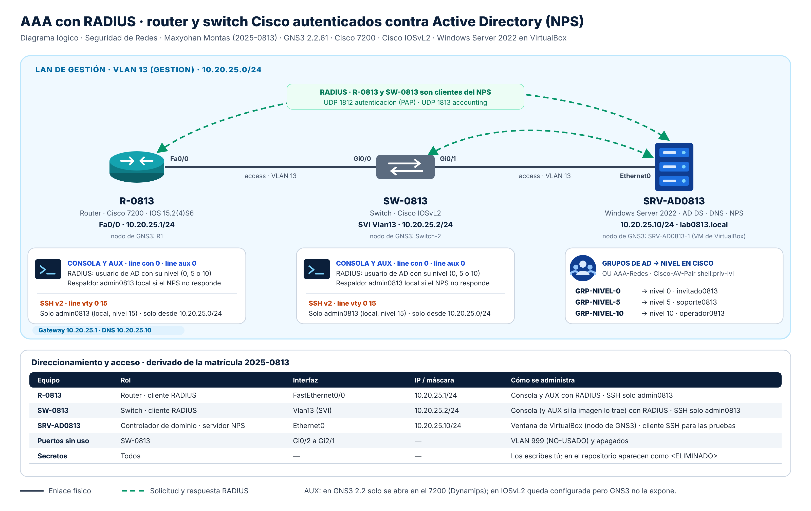

<p align="center">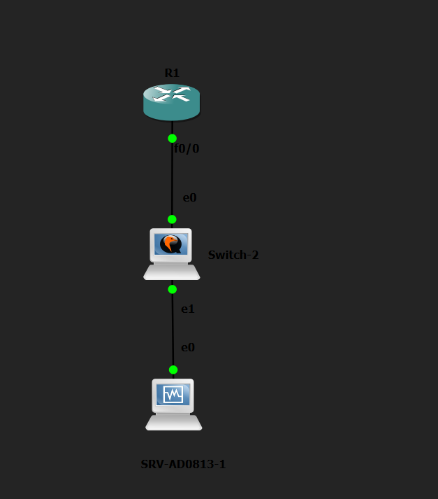<br><em>Proyecto en GNS3. Los nodos conservan el nombre de la plantilla (R1, Switch-2, SRV-AD0813-1): GNS3 no deja renombrar un nodo Dynamips encendido. Dentro de cada equipo el hostname es el de la práctica.</em></p>

### Cableado

| Nodo en GNS3 | Puerto | ↔ | Nodo en GNS3 | Puerto |
|---|---|:---:|---|---|
| R1 (R-0813) | f0/0 = FastEthernet0/0 | ↔ | Switch-2 (SW-0813) | e0 = GigabitEthernet0/0 |
| SRV-AD0813-1 (SRV-AD0813) | e0 = adaptador `Ethernet` | ↔ | Switch-2 (SW-0813) | e1 = GigabitEthernet0/1 |

### Direccionamiento (derivado de la matrícula 2025-0813)

| Equipo | Rol | Interfaz | IP / máscara | Gateway | DNS |
|---|---|---|---|---|---|
| R-0813 | Router · cliente RADIUS | FastEthernet0/0 | 10.20.25.1/24 | — | — |
| SW-0813 | Switch · cliente RADIUS | Vlan13 (VLAN 13 GESTION) | 10.20.25.2/24 | 10.20.25.1 | — |
| SRV-AD0813 | AD DS + DNS + NPS · `lab0813.local` | Ethernet | 10.20.25.10/24 | 10.20.25.1 | 10.20.25.10 |

VLAN 13 `GESTION` para los puertos en uso y VLAN 999 `NO-USADO` para los ocho puertos libres del switch, que además quedan apagados.

### Plataforma

| Componente | Versión y detalle |
|---|---|
| Emulador | GNS3 2.2.61 con la GNS3 VM en VirtualBox |
| Router | Cisco 7200 (Dynamips) · IOS 15.2(4)S6 |
| Switch | Cisco IOSvL2 (QEMU) · plantilla de 10 puertos: Gi0/0-3, Gi1/0-3, Gi2/0-1 |
| Servidor | Windows Server 2022 Standard Evaluation en una VM de VirtualBox (4 GB de RAM) añadida a GNS3 como nodo VirtualBox |

## Diseño AAA

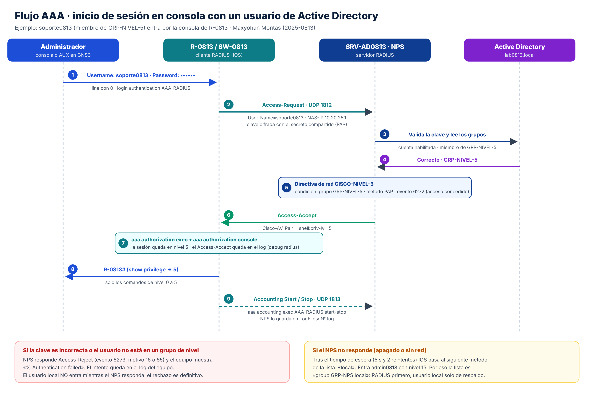

| Línea | Autenticación | Autorización | Accounting |
|---|---|---|---|
| `line con 0` · `line aux 0` | `AAA-RADIUS` = `group GRP-NPS local`: NPS primero; el usuario local solo si el NPS no responde | `AAA-RADIUS` + `aaa authorization console`: el nivel lo da el NPS | `AAA-RADIUS` start-stop al NPS |
| `line vty 0 15` | `AAA-LOCAL` = `local`: solo `admin0813`, solo SSH v2, ACL `ACL-SSH` | `AAA-LOCAL` | — |
| `enable` | `aaa authentication enable default enable`: clave propia de cada nivel (5, 10 y 15) | — | Cada cambio de nivel queda en el log (`archive log config`) |

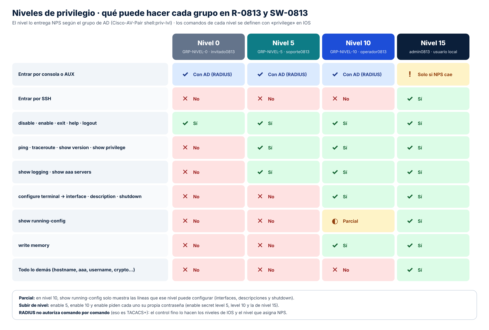

| Nivel | Quién | Qué puede hacer |
|---|---|---|
| 0 | GRP-NIVEL-0 · `invitado0813` | `disable`, `enable`, `exit`, `help`, `logout` |
| 5 | GRP-NIVEL-5 · `soporte0813` | Lo anterior y diagnóstico: `ping`, `show version`, `show logging`, `show aaa servers` |
| 10 | GRP-NIVEL-10 · `operador0813` | Lo anterior, `configure terminal` → `interface` → `description` / `shutdown`, `write memory` y `show running-config` (solo lo que puede configurar) |
| 15 | `admin0813` (local) y `enable` | Todo |

## Configuración

| Equipo | Qué se configuró | Script |
|---|---|---|
| **SRV-AD0813** | Red, bosque `lab0813.local`, OU `AAA-Redes`, grupos de nivel con un usuario cada uno, NPS registrado en AD, clientes RADIUS, tres directivas de red, auditoría y *accounting* | [`scripts/SRV-AD0813_config.ps1`](scripts/SRV-AD0813_config.ps1) |
| **R-0813** | Endurecimiento, usuario local, clave por nivel, comandos de los niveles 5 y 10, SSH v2, cliente RADIUS, AAA en consola y AUX, registros | [`scripts/R-0813_config.txt`](scripts/R-0813_config.txt) |
| **SW-0813** | Lo mismo que el router, más VLAN de gestión, puertos sin uso y la sintaxis `radius server` de IOSvL2 | [`scripts/SW-0813_config.txt`](scripts/SW-0813_config.txt) |

### Servidor SRV-AD0813 · Active Directory y NPS

| Equipo y dominio | Active Directory · OU AAA-Redes |
|:---:|:---:|
| 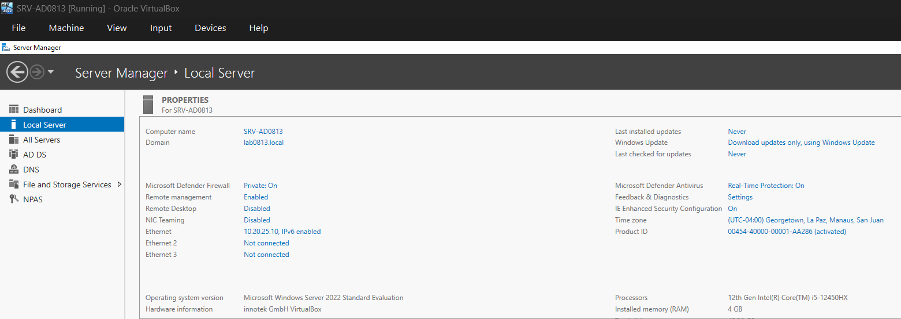 | 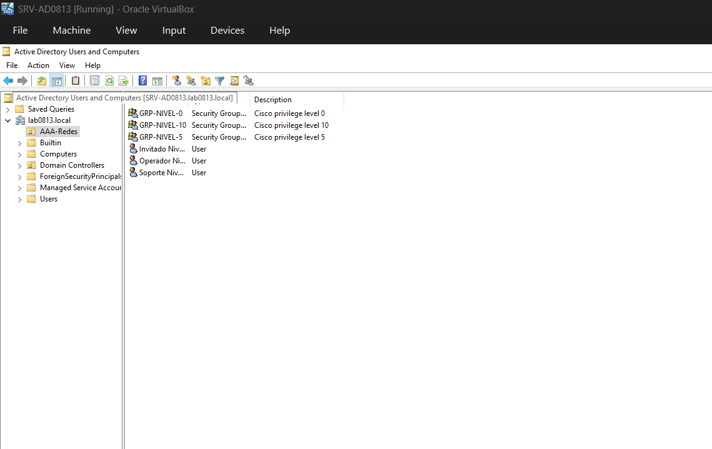 |
| **NPS · clientes RADIUS** | **NPS · directivas de red (orden 1, 2 y 3)** |
| 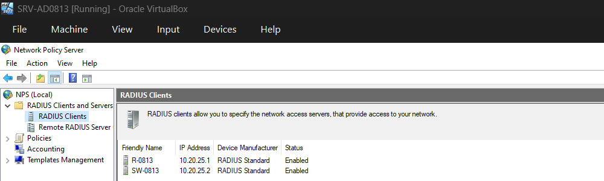 | 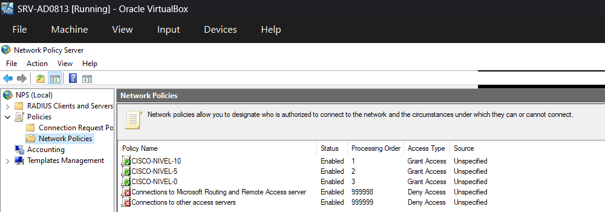 |

Cada directiva **CISCO-NIVEL-N** tiene la condición *User Groups* = `LAB0813\GRP-NIVEL-N`, concede el acceso, usa **PAP** y envía **Cisco-AV-Pair = `shell:priv-lvl=N`**. El *accounting* se guarda en `C:\Windows\system32\LogFiles` (formato DTS, un archivo por mes) y la auditoría registra los eventos 6272 y 6273.

| Directiva CISCO-NIVEL-0 · Cisco-AV-Pair | Accounting a archivo |
|:---:|:---:|
| 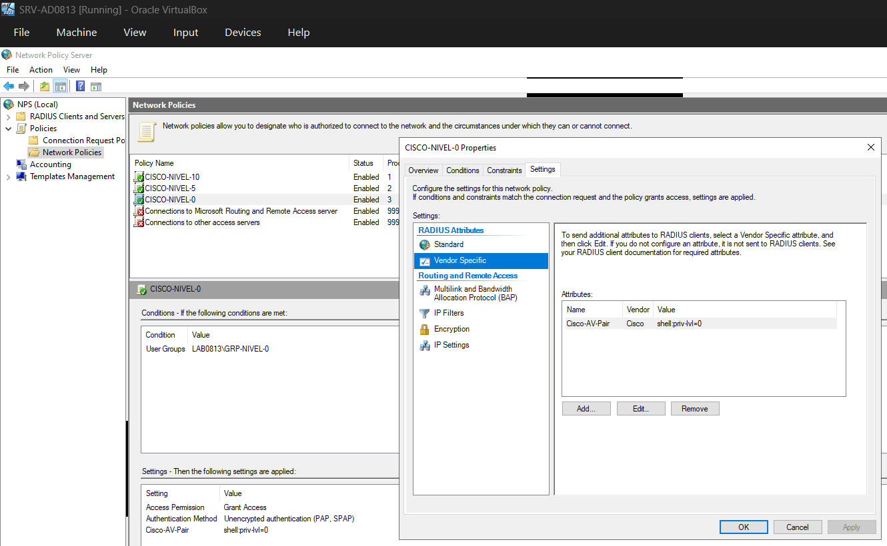 | 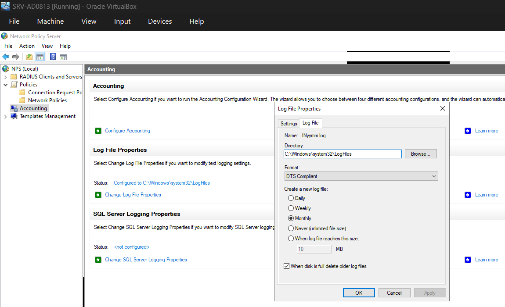 |

Detalle completo: [`configs/SRV-AD0813_nps-config.md`](configs/SRV-AD0813_nps-config.md).

### Router R-0813 · cliente RADIUS y AAA

```
radius-server host 10.20.25.10 auth-port 1812 acct-port 1813 key <CLAVE-RADIUS>
radius-server timeout 5
radius-server retransmit 2
aaa group server radius GRP-NPS
 server 10.20.25.10 auth-port 1812 acct-port 1813
 ip radius source-interface FastEthernet0/0
!
aaa authentication login AAA-LOCAL local
aaa authorization exec AAA-LOCAL local
aaa authentication login AAA-RADIUS group GRP-NPS local
aaa authorization exec AAA-RADIUS group GRP-NPS local
aaa authorization console
aaa authentication enable default enable
aaa accounting exec AAA-RADIUS start-stop group GRP-NPS
!
line con 0
 no privilege level 15
 login authentication AAA-RADIUS
 authorization exec AAA-RADIUS
 accounting exec AAA-RADIUS
line aux 0
 (lo mismo que la consola)
line vty 0 15
 access-class ACL-SSH in
 login authentication AAA-LOCAL
 authorization exec AAA-LOCAL
 transport input ssh
```

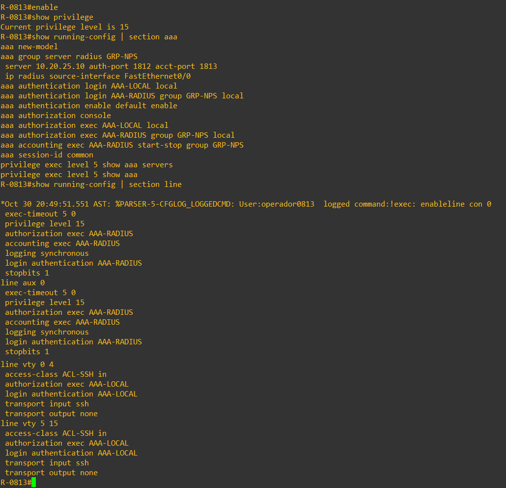

### Switch SW-0813 · VLAN de gestión, SSH y RADIUS

IOSvL2 ya no acepta `radius-server host … key …` ([evidencia 21](docs/Evidencias/21-sw-radius-sintaxis-antigua.png)); el servidor se define con nombre y el grupo lo referencia:

```
radius server NPS-0813
 address ipv4 10.20.25.10 auth-port 1812 acct-port 1813
 key <CLAVE-RADIUS>
aaa group server radius GRP-NPS
 server name NPS-0813
 ip radius source-interface Vlan13
```

| VLAN 13 y puertos sin uso | SSH v2 y ACL de las vty |
|:---:|:---:|
| 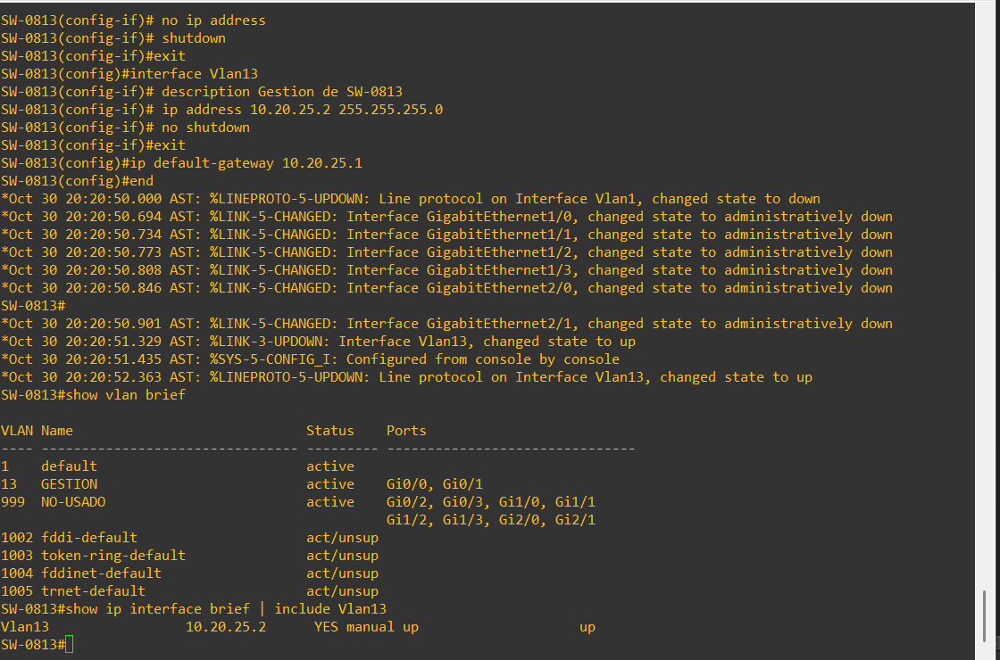 | 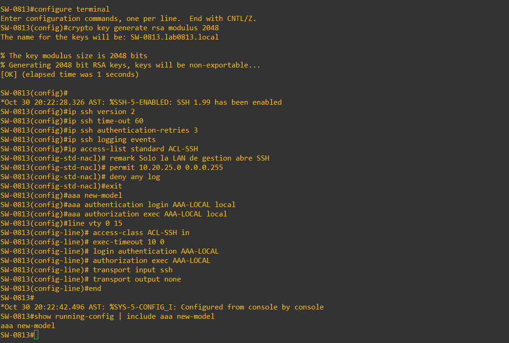 |
| **`show ip ssh` y guardado** | **`section aaa` del switch** |
| 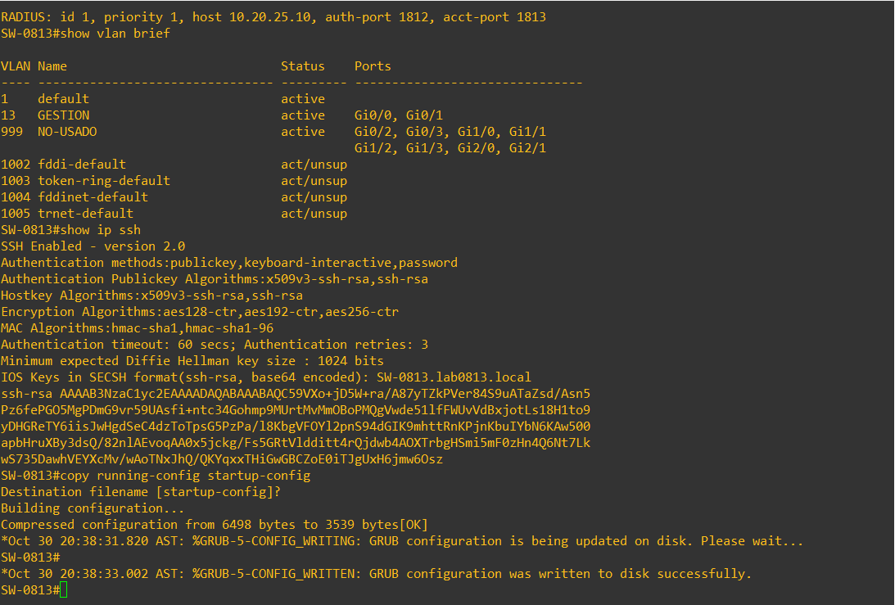 | 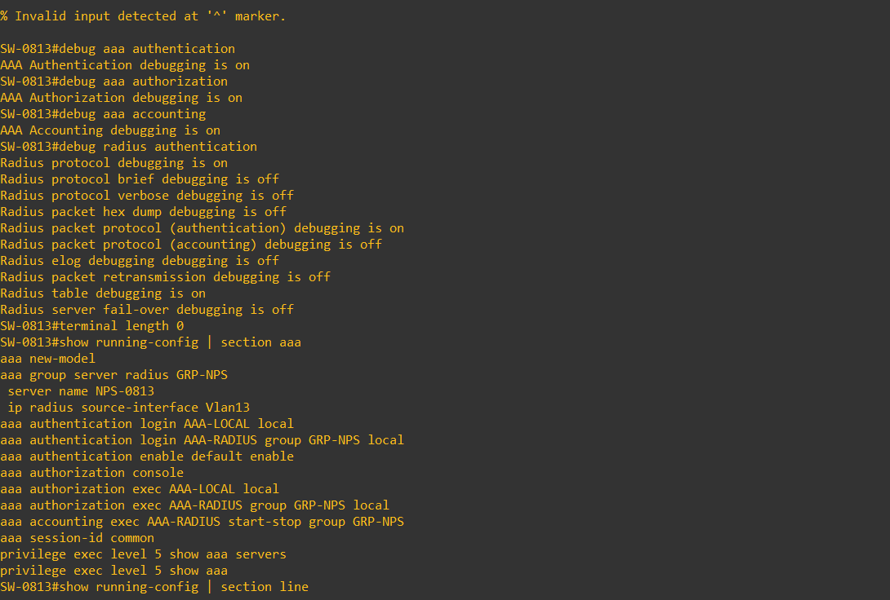 |

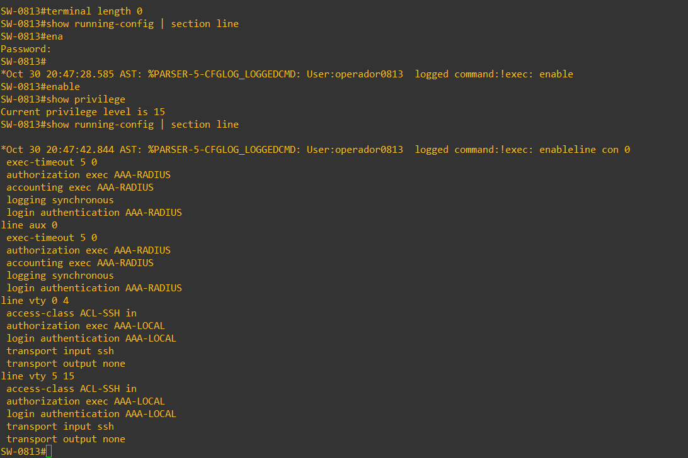

### Endurecimiento aplicado en los dos equipos

- `service password-encryption`, `security passwords min-length 10` y claves tipo `secret`.
- `no ip http server`, `no ip http secure-server`, `no ip domain-lookup` y aviso legal (`banner motd`).
- `exec-timeout 5 0` en consola y AUX; `login block-for 120 attempts 3 within 60` contra fuerza bruta.
- SSH v2 con llaves RSA de 2048 bits, `ip ssh time-out 60` y `ip ssh authentication-retries 3`; las vty solo aceptan SSH desde `10.20.25.0/24` y registran lo que la ACL niega.
- Switch: puertos sin uso en VLAN 999 y apagados, `Vlan1` apagada, `switchport nonegotiate` en los puertos de acceso y `spanning-tree bpduguard enable` en el puerto del servidor.

## Pruebas y resultados

| # | Prueba | Resultado obtenido | Evidencia |
|---|---|---|---|
| 1 | `ping 10.20.25.10` desde R-0813 y SW-0813 | 100 % (5/5) en los dos equipos | [14](docs/Evidencias/14-r-test-aaa-radius.png) · [15](docs/Evidencias/15-sw-test-aaa-radius.png) |
| 2 | `test aaa group GRP-NPS soporte0813 … new-code` en R-0813 | *User successfully authenticated* con `priv-lvl 5`. La depuración muestra el Access-Request a 10.20.25.10:1812 y el **Access-Accept** con `Cisco AVpair "shell:priv-lvl=5"` | [14](docs/Evidencias/14-r-test-aaa-radius.png) |
| 3 | La misma prueba en SW-0813 | *User successfully authenticated* con `priv-lvl 5`; `show aaa servers` muestra el host 10.20.25.10 | [15](docs/Evidencias/15-sw-test-aaa-radius.png) |
| 4 | Consola de R-0813 con `operador0813` (GRP-NIVEL-10) | Entra con su cuenta de AD: `%SEC_LOGIN-5-LOGIN_SUCCESS`. En nivel 10, `show running-config \| section aaa` y `\| section line` no devuelven nada: ese nivel solo ve lo que puede configurar | [16](docs/Evidencias/16-r-consola-ad-nivel10.png) |
| 5 | Consola de SW-0813 con `operador0813` | Mismo resultado en el switch | [17](docs/Evidencias/17-sw-consola-ad-nivel10.png) |
| 6 | `enable` desde la sesión de `operador0813` | Pide la clave de enable, `show privilege` = 15 y queda registrado: `%PARSER-5-CFGLOG_LOGGEDCMD: User:operador0813 logged command:!exec: enable` | [08](docs/Evidencias/08-r-aaa-config.png) · [10](docs/Evidencias/10-sw-line-config.png) |
| 7 | Consola inactiva | `exec-timeout` cierra la sesión: `%SYS-6-TTY_EXPIRE_TIMER` y `%SYS-6-LOGOUT` | [16](docs/Evidencias/16-r-consola-ad-nivel10.png) |
| 8 | SSH desde SRV-AD0813 a R-0813 con tres claves incorrectas | Negocia SSH v2 con `aes128-cbc`. Cada fallo queda registrado (`%SEC_LOGIN-4-LOGIN_FAILED`, `%SSH-5-SSH2_USERAUTH … Failed`); al tercero, `%SEC_LOGIN-1-QUIET_MODE_ON` y `show login` muestra el Quiet-Mode de 120 s | [18](docs/Evidencias/18-r-ssh-login-block-for.png) |
| 9 | Consola durante el Quiet-Mode | `operador0813` entra por consola con RADIUS: el bloqueo solo afecta al acceso remoto | [18](docs/Evidencias/18-r-ssh-login-block-for.png) |
| 10 | Credenciales que no coinciden | El NPS rechaza y lo registra: evento **6273**, motivo **16** | [19](docs/Evidencias/19-nps-evento-6273.png) |

| `test aaa` en R-0813 con la respuesta del NPS | `test aaa` en SW-0813 |
|:---:|:---:|
| 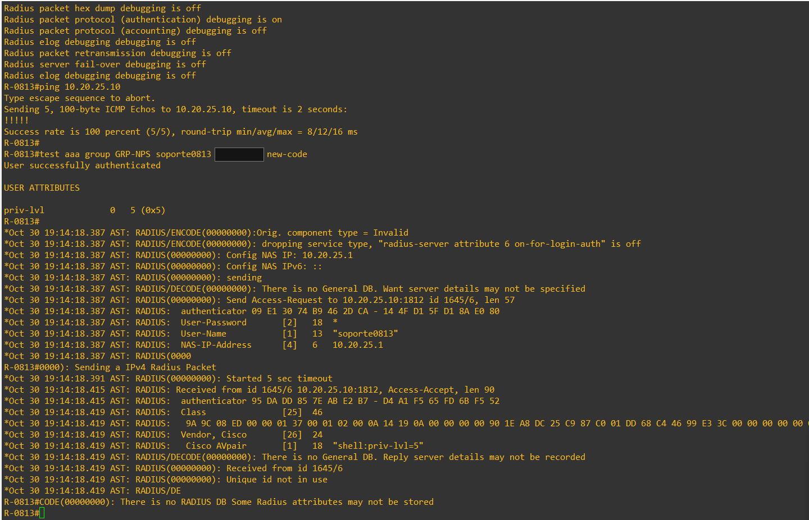 | 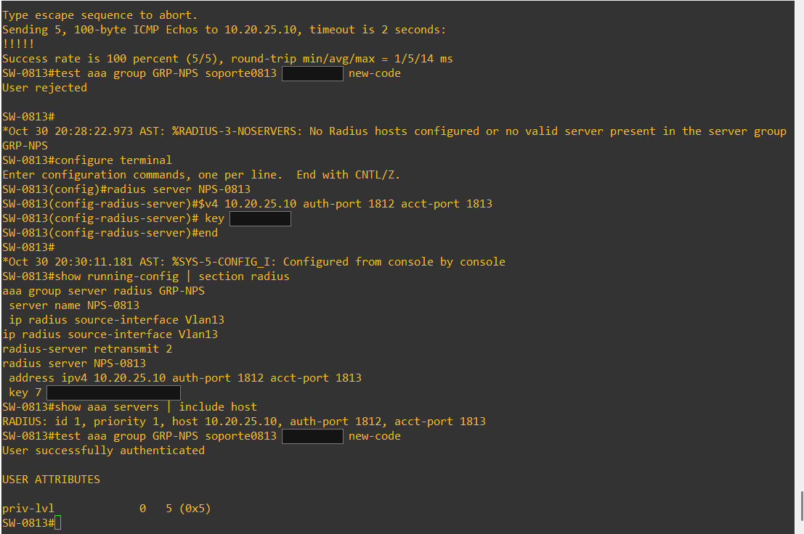 |
| **Consola de R-0813 con un usuario de AD** | **Consola de SW-0813 con un usuario de AD** |
| 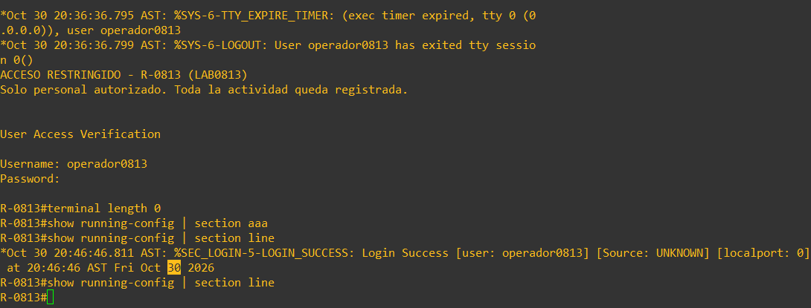 | 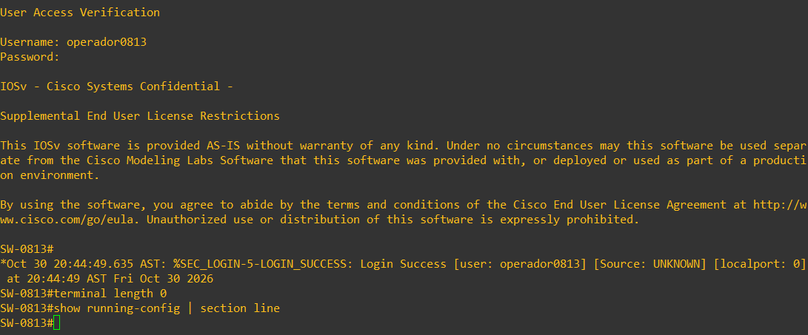 |

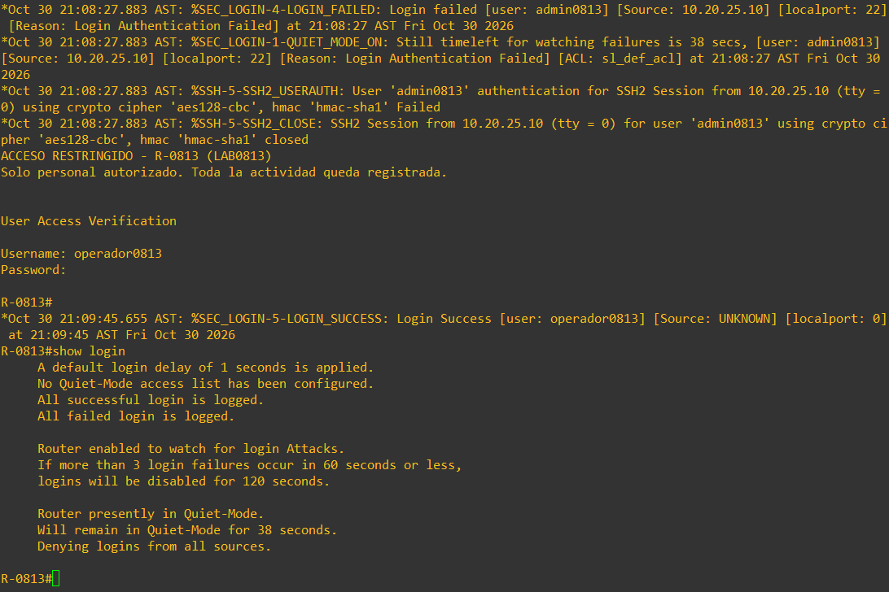

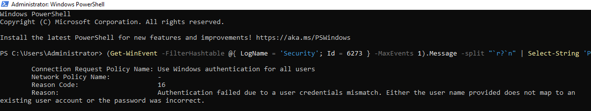

## Registros

| Mensaje | Qué registra | Evidencia |
|---|---|---|
| `%SEC_LOGIN-5-LOGIN_SUCCESS` | Inicio de sesión correcto: usuario, origen y puerto | [16](docs/Evidencias/16-r-consola-ad-nivel10.png) · [17](docs/Evidencias/17-sw-consola-ad-nivel10.png) · [18](docs/Evidencias/18-r-ssh-login-block-for.png) |
| `%SEC_LOGIN-4-LOGIN_FAILED` | Intento fallido con el motivo | [18](docs/Evidencias/18-r-ssh-login-block-for.png) |
| `%SEC_LOGIN-1-QUIET_MODE_ON` | Bloqueo por `login block-for` | [18](docs/Evidencias/18-r-ssh-login-block-for.png) |
| `%SSH-5-SSH2_USERAUTH` · `%SSH-5-SSH2_CLOSE` | Autenticación SSH: usuario, IP de origen, cifrado y resultado | [18](docs/Evidencias/18-r-ssh-login-block-for.png) |
| `%PARSER-5-CFGLOG_LOGGEDCMD` | Comandos de configuración y cambios de nivel, con el usuario (`archive log config`) | [08](docs/Evidencias/08-r-aaa-config.png) · [10](docs/Evidencias/10-sw-line-config.png) |
| `%SYS-6-TTY_EXPIRE_TIMER` · `%SYS-6-LOGOUT` | Cierre de sesión por inactividad | [16](docs/Evidencias/16-r-consola-ad-nivel10.png) |
| `RADIUS: Send Access-Request` · `Access-Accept` · `Cisco AVpair` | Diálogo RADIUS con el NPS y nivel recibido (`debug radius authentication`) | [14](docs/Evidencias/14-r-test-aaa-radius.png) |
| `%RADIUS-3-NOSERVERS` · `%RADIUS-4-NOSERV` | Grupo RADIUS sin un servidor válido definido | [15](docs/Evidencias/15-sw-test-aaa-radius.png) · [21](docs/Evidencias/21-sw-radius-sintaxis-antigua.png) |
| NPS · evento 6272 / 6273 | Acceso concedido / denegado, con la directiva y el motivo | [19](docs/Evidencias/19-nps-evento-6273.png) |
| NPS · `INyymm.log` | *Accounting*: solicitudes y sesiones Start / Stop de los equipos | [07](docs/Evidencias/07-nps-accounting.png) |

En los equipos: `show logging`, `show login` y `show aaa servers`. En el servidor: Visor de eventos ▸ *Security* (6272 y 6273) y `C:\Windows\system32\LogFiles\IN*.log`.

## Problemas y soluciones

| Problema | Causa | Solución |
|---|---|---|
| La instalación de Windows Server se quedaba en el logo | El servidor corría en QEMU dentro de la GNS3 VM (virtualización anidada) | Se movió a una VM de VirtualBox y se añadió a GNS3 como nodo VirtualBox |
| El servidor tomaba una IP 192.168.56.x | El adaptador de VirtualBox estaba en *host-only* | Adaptador 1 en *Not attached*: GNS3 lo conecta al switch con su propio enlace |
| Aparecían «Ethernet 2» y «Ethernet 3» | Adaptadores extra de la VM | La IP se puso solo en el adaptador `Ethernet` ([02](docs/Evidencias/02-srv-red-y-dominio.png)) |
| NPS rechazaba con el motivo 16 | El teclado US de la VM cambiaba la `@` al escribir las claves de AD | Se restablecieron pegando el texto con `Set-ADAccountPassword` ([19](docs/Evidencias/19-nps-evento-6273.png)) |
| `%RADIUS-4-RADIUS_DEAD` en el router | Secreto compartido distinto en el NPS y en el equipo | Mismo secreto en los dos lados (`Set-NpsRadiusClient` y `key` en IOS) |
| El atributo salía como «Vendor-Specific» genérico | `netsh` crea el VSA sin nombre | Se dejó como **Cisco-AV-Pair** en la consola de NPS ([06](docs/Evidencias/06-nps-atributo-priv-lvl.png)) |
| `% Invalid input` en `radius-server host … key …` del switch | IOSvL2 usa la sintaxis nueva | `radius server NPS-0813` + `server name` en el grupo ([21](docs/Evidencias/21-sw-radius-sintaxis-antigua.png) · [15](docs/Evidencias/15-sw-test-aaa-radius.png)) |
| Comandos AAA rechazados en el switch | Faltaba `aaa new-model` | Se aplicó primero `aaa new-model` y luego los bloques en partes más cortas |
| Cables invertidos en GNS3 | El router y el servidor estaban en puertos cruzados | R1 f0/0 → e0 (Gi0/0) y SRV e0 → e1 (Gi0/1) |
| `no matching cipher found` al hacer SSH al router | IOS 15.2(4)S del 7200 solo ofrece cifrados CBC | `ssh -c aes128-cbc admin0813@10.20.25.1` ([20](docs/Evidencias/20-ssh-cifrados-cbc.png)) |
| `Connection refused` al reintentar SSH | `login block-for` activó el Quiet-Mode tras tres fallos | Esperar los 120 s (comportamiento esperado) ([18](docs/Evidencias/18-r-ssh-login-block-for.png)) |
| `privilege level 15` en con 0 y aux 0 del router | Plantilla por defecto del 7200 en GNS3 | `no privilege level 15` en las dos líneas |
| En nivel 10, `show running-config` sale vacío | Ese nivel solo ve lo que puede configurar | Comportamiento esperado; con `enable` (nivel 15) se ve completo |

## Running-configs y scripts

| Equipo | Running-config | Script |
|---|---|---|
| R-0813 | [`configs/R-0813_running-config.txt`](configs/R-0813_running-config.txt) | [`scripts/R-0813_config.txt`](scripts/R-0813_config.txt) |
| SW-0813 | [`configs/SW-0813_running-config.txt`](configs/SW-0813_running-config.txt) | [`scripts/SW-0813_config.txt`](scripts/SW-0813_config.txt) |
| SRV-AD0813 | [`configs/SRV-AD0813_nps-config.md`](configs/SRV-AD0813_nps-config.md) | [`scripts/SRV-AD0813_config.ps1`](scripts/SRV-AD0813_config.ps1) |
| Repositorio | — | [`scripts/limpiar-secretos.ps1`](scripts/limpiar-secretos.ps1) |

- **Servidor:** cada parte del `.ps1` se pega en PowerShell como administrador, en orden (1 a 7). Las claves y el secreto RADIUS se escriben cuando la parte los pide.
- **Router y switch:** cada bloque del `.txt` se pega en la consola, en orden (1 a 8), cambiando cada `<CLAVE-…>`.
- **Antes de publicar:** `limpiar-secretos.ps1` cambia claves, hashes y el secreto RADIUS de los running-config por `<ELIMINADO>`.

## Estructura del repositorio

```
aaa-radius-nps-0813/
├── README.md
├── configs/
│   ├── R-0813_running-config.txt
│   ├── SW-0813_running-config.txt
│   └── SRV-AD0813_nps-config.md
├── docs/
│   ├── Documentacion_AAA-RADIUS_2025-0813.pdf
│   ├── Documentacion_AAA-RADIUS_2025-0813.docx
│   ├── Diagramas/      portada del video, topología, flujo AAA y niveles (PNG + fuente HTML)
│   └── Evidencias/     21 capturas numeradas (ver LEEME.md)
└── scripts/
    ├── SRV-AD0813_config.ps1
    ├── R-0813_config.txt
    ├── SW-0813_config.txt
    └── limpiar-secretos.ps1
```

**Seguridad del repositorio:** no se publican contraseñas, hashes, el secreto RADIUS ni la clave DSRM. En los scripts aparecen como `<CLAVE-…>` y en los running-config como `<ELIMINADO>`; en las capturas están tapados.

## Conclusiones

- Con **NPS como servidor RADIUS** las cuentas de los equipos de red dependen de **Active Directory**: dar de alta, cambiar el nivel o quitar el acceso a alguien se hace moviendo al usuario de grupo, sin tocar el router ni el switch.
- El **nivel de privilegio viaja en la respuesta RADIUS** (`shell:priv-lvl`) y IOS lo aplica gracias a `aaa authorization exec` y `aaa authorization console`; sin esta última, la consola ignora la autorización.
- La lista `group GRP-NPS local` mantiene el acceso si el servidor cae, sin abrir una puerta trasera: el usuario local solo entra cuando el NPS no responde.
- Separar las líneas (RADIUS en consola y AUX, usuario local y SSH v2 en las vty) junto con `login block-for` y la ACL reduce la superficie de ataque y deja **registro de cada intento** en el equipo y en el servidor.

## Referencias

- Cisco · [Configuring Authorization](https://www.cisco.com/c/en/us/td/docs/ios-xml/ios/sec_usr_aaa/configuration/15-mt/sec-usr-aaa-15-mt-book/sec-cfg-authorizatn.html)
- Cisco · [Configuring Security with Passwords, Privileges, and Logins](https://www.cisco.com/c/en/us/td/docs/ios-xml/ios/sec_usr_cfg/configuration/15-mt/sec-usr-cfg-15-mt-book/sec-cfg-sec-4cli.html)
- Cisco · [Cisco IOS Login Enhancements (login block-for)](https://www.cisco.com/c/en/us/td/docs/ios-xml/ios/sec_usr_cfg/configuration/15-mt/sec-usr-cfg-15-mt-book/sec-login-enhance.html)
- Microsoft · [Configure RADIUS Clients (NPS)](https://learn.microsoft.com/en-us/windows-server/networking/technologies/nps/nps-radius-clients-configure)
- Microsoft · [Configure Network Policies (NPS)](https://learn.microsoft.com/en-us/windows-server/networking/technologies/nps/nps-np-configure)
- Microsoft · [Configure Network Policy Server Accounting](https://learn.microsoft.com/en-us/windows-server/networking/technologies/nps/nps-accounting-configure)
- Microsoft · [Audit Network Policy Server](https://learn.microsoft.com/windows/security/threat-protection/auditing/audit-network-policy-server)
- Microsoft · [Install-ADDSForest](https://learn.microsoft.com/en-us/powershell/module/addsdeployment/install-addsforest)
